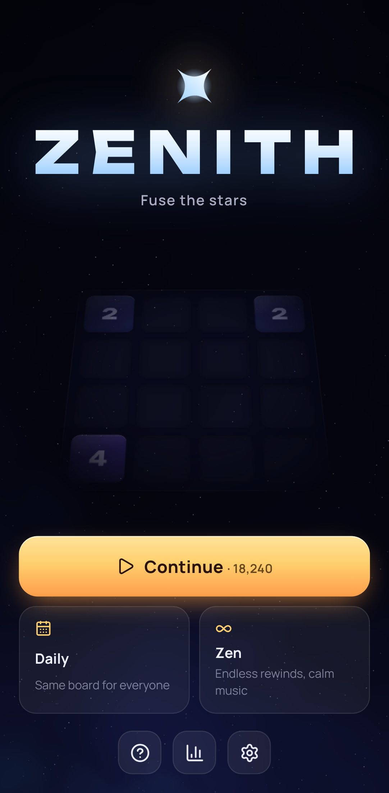
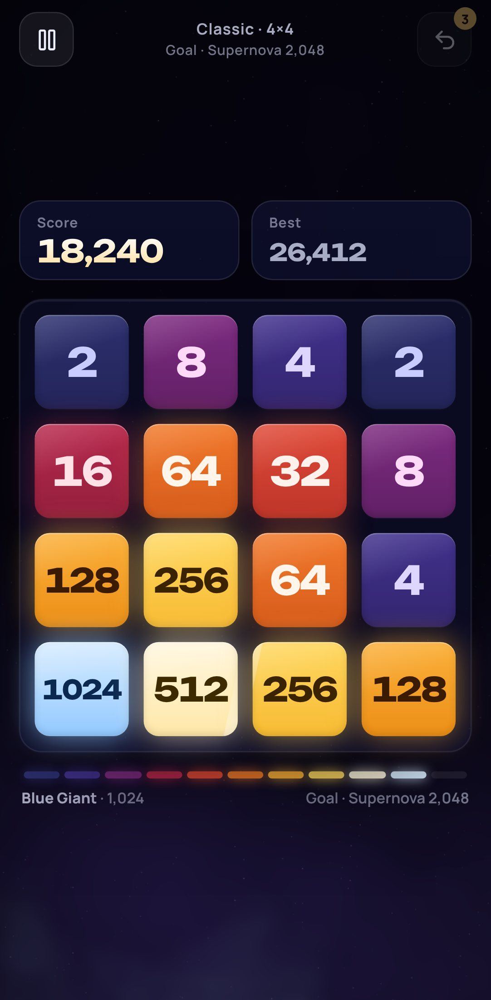
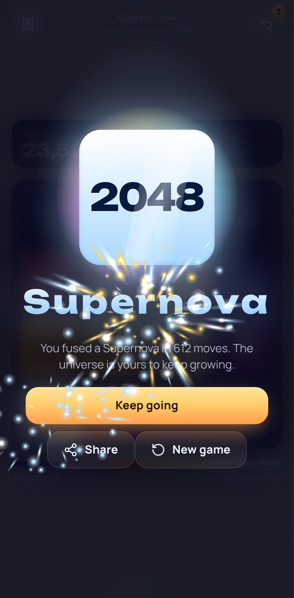
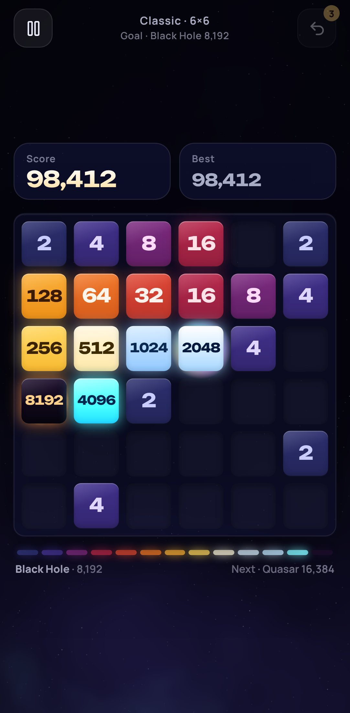
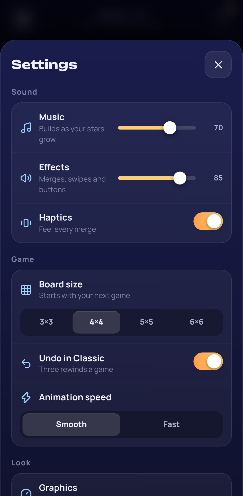
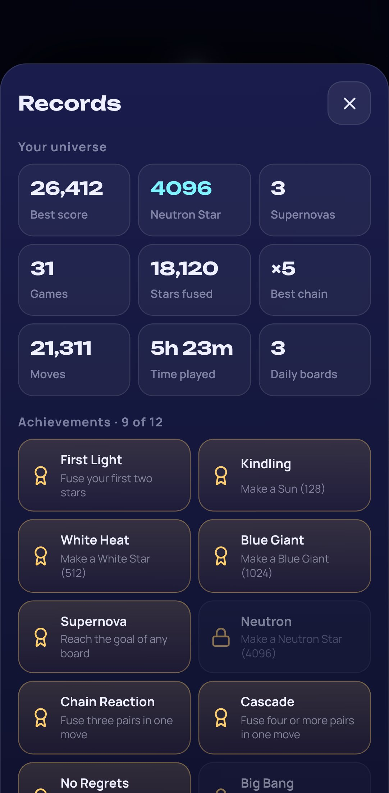
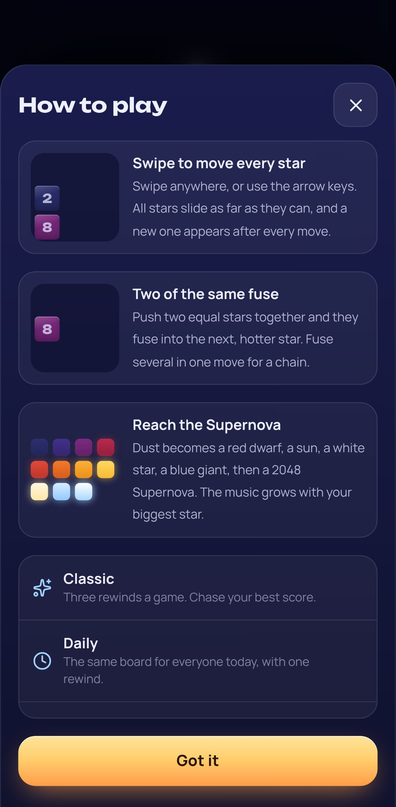
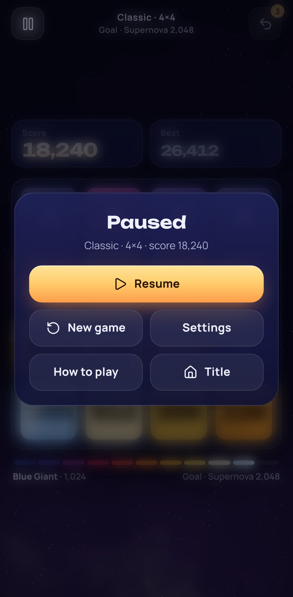

# Zenith: a 2048 merge puzzle with a living soundtrack (Android, iPhone and web)

Zenith is 2048 where every tile is a star. Push two of the same together and they fuse into a hotter one: stardust becomes a red dwarf, a sun, a white star, a blue giant, and at 2048 a **Supernova**. The soundtrack grows with your game. It starts as a single pad, adds an arpeggio, a galloping bass, war drums, a choir and finally a full heroic theme as your biggest star climbs. Every merge rings a note in tune with the music, so your moves play the melody.

**Play it:** [neomaverick1.github.io/zenith](https://neomaverick1.github.io/zenith/), with sound on.

**Phone apps:** [download Zenith.apk](https://neomaverick1.github.io/zenith/Zenith.apk) for Android, or the [latest release](https://github.com/neomaverick1/zenith/releases/latest). On iPhone, open the game in Safari, tap Share, then **Add to Home Screen**. The Android and iOS projects are [Capacitor](https://capacitorjs.com) apps in [`android/`](android) and [`ios/`](ios).

<p>
  
  
  
  
</p>
<p>
  
  
  
  
</p>

Every push to `main` type-checks, lints and tests the code, rebuilds and redeploys the web version, builds the Android APK, the Google Play bundle and the iOS app, and publishes a release ([`.github/workflows/build.yml`](.github/workflows/build.yml)).

## What makes it different

| | |
| --- | --- |
| **A soundtrack that grows with you** | Six layers in D minor at 100 beats a minute: a pad, an arpeggio with a ping-pong echo, a galloping bass, synthesized taiko war drums, a choir and a heroic lead theme. They fade in on the downbeat as your biggest star reaches 16, 64, 256, 1024 and 2048, with a cinematic hit to mark each new layer. Zen mode keeps it calm. |
| **Merges you can hear** | Each merge rings a bell tuned to the chord playing at that moment, one step higher for every doubling, panned to where it happened on the board. Several merges in one move strum like a harp. 512 and up add a deep boom and the music ducks to make room; 1024 brings the trailer horn. |
| **No sound files at all** | Every instrument, drum, reverb hall and effect is built from oscillators, noise and filters as it plays (Web Audio). The whole soundtrack costs zero bytes to download and never repeats exactly. |
| **A sky that reacts** | The background is a nebula drawn on the graphics chip. It warms from deep blue to violet and gold as the game goes on, and every merge sends a shockwave through it, tinted with the star's color. Reaching the goal floods it with light. |
| **The Supernova** | At 2048 the music cuts out, a hit and a horn land, a choir swells on a D major chord, and the full theme comes back two bars later at its peak. |
| **Feel** | Slides run on the graphics chip, merges pop with a spring, sparks burst in each star's color, big merges shake the board, and haptics are tuned per moment on Android and iPhone. A swipe that can't move anything bumps the board with a soft knock. |
| **Modes** | Classic (three rewinds a game), Daily (the same board for everyone that day, built from the date) and Zen (endless rewinds, calm music). Boards from 3×3 to 6×6, with the goal growing with the board: Yellow Giant 256 on 3×3, Supernova 2048 on 4×4, Neutron Star 4096 on 5×5, Black Hole 8192 on 6×6. |
| **Records** | Best scores by mode and size, biggest star, Supernovas, chains, moves, time played, daily boards, and twelve achievements. The game in progress is saved, so you can leave and come back. |
| **Settings** | Music and effects volume, haptics, board size, undo, animation speed, graphics quality (Ultra, Balanced, Battery saver), reduce motion, star names on tiles, and color-blind marks so color is never needed to tell stars apart. |

## How it's built

- [`src/game/engine.ts`](src/game/engine.ts): the game itself, with no screen attached. Every move returns a new game, so undo is just going back one, and the screen animates from the old game to the new one. The merged stars are kept for one frame as "ghosts" so they can visibly slide into each other. Daily boards use a seeded random number generator, so the same date gives everyone the same board and the same new stars.
- [`src/audio/theory.ts`](src/audio/theory.ts): the music as data: the chord progression, arpeggio, bass and drum patterns, the theme, and which layers play at each intensity.
- [`src/audio/instruments.ts`](src/audio/instruments.ts) and [`src/audio/sound.ts`](src/audio/sound.ts): the synthesizers and the scheduler, which looks 150 ms ahead and places every note on the beat, independent of the screen.
- [`src/fx/nebula.ts`](src/fx/nebula.ts): the sky shader, drawn at a fraction of the screen's resolution for speed. [`src/fx/particles.ts`](src/fx/particles.ts): the sparks, with additive light, only running while sparks are alive.
- [`src/game/autoplay.ts`](src/game/autoplay.ts): the player behind the title screen, which looks one move ahead and keeps its biggest star in a corner.
- **Tests:** [`engine.test.ts`](src/game/engine.test.ts) covers every move, merge rule, undo, the end of the game and daily boards, and checks the demo player reaches 256. [`theory.test.ts`](src/audio/theory.test.ts) checks that every merge note, arpeggio note and pad note is a tone of the chord playing, so the game can never play a wrong note.

## Built with

- **React 19 + TypeScript**, built with **Vite**. No game engine and no UI kit: the board, the effects and the music are written for this game.
- **Web Audio** for all sound, **WebGL** for the sky, **Canvas** for the sparks.
- **Capacitor 8** for the Android and iOS apps, with haptics, sharing and the back button.
- **oxlint** and **Vitest**; GitHub Actions for the checks, the APK, the Play bundle, the iOS build, the release and the web version.

## Run it

```bash
npm install
npm run dev          # the game at http://localhost:5173
npm test             # engine and music tests
npm run build        # production build in dist/
npm run android      # build and copy into android/, then open it in Android Studio
npm run ios          # build and copy into ios/, then open ios/App in Xcode
```

Keys on a computer: arrows or WASD to move, Z to undo, Esc to pause.
